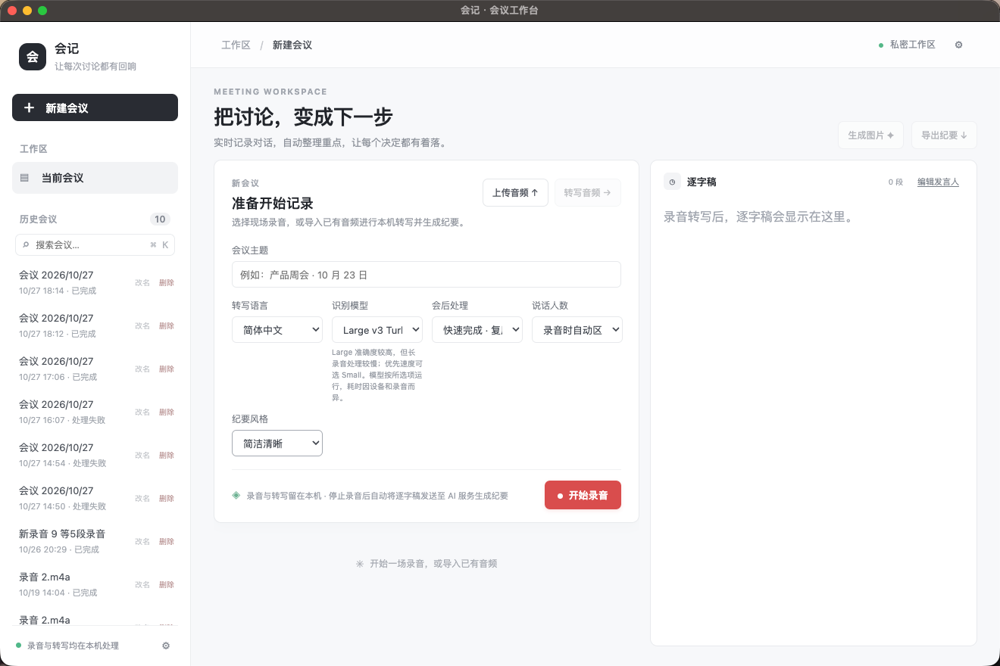
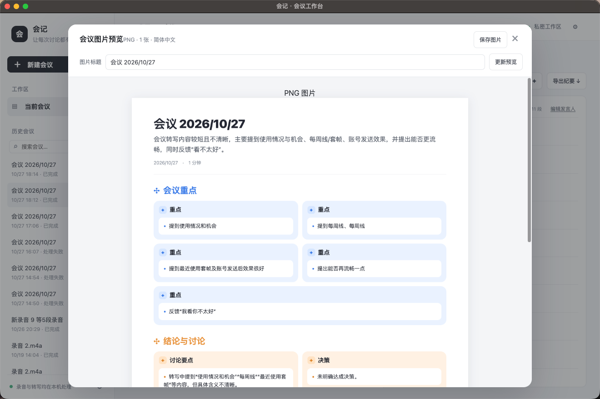
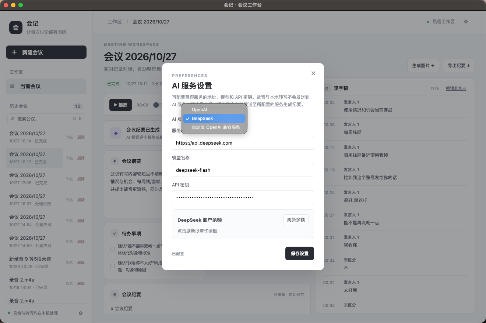

# 会议纪要助手

一款面向 macOS 和 Windows 的桌面会议记录工具。支持本机录音与实时转写、发言人区分、导入音频、AI 生成会议纪要和待办，并可搜索历史会议。

> 项目仍在积极开发中。转写准确率受麦克风、环境噪声、口音和设备性能影响；请在正式使用前自行核对重要内容。

## 功能

- 录音时实时显示转写，并尝试同步区分发言人。
- 导入单个或多个音频文件；可调整顺序，在本机拼接并转写。
- 会后生成摘要、重点、会议纪要和待办。
- 保存、搜索、改名和删除历史会议；支持编辑、复制和导出 Markdown。
- 将纪要排版生成 PNG 图片。
- 可配置 OpenAI、DeepSeek 或其他 OpenAI 兼容服务。
- Whisper、流式语音识别、标点和声纹区分在本机运行。

## 界面展示

### 新建会议与录音



### 会议纪要图片预览



### AI 服务设置



## 隐私说明

- 录音、音频拼接和本地语音识别在本机完成。默认数据目录为 macOS 的 `~/Library/Application Support/huiyi-jiyao` 和 Windows 的 `%APPDATA%\\huiyi-jiyao`。
- 只有点击生成 AI 纪要时，逐字稿才会发送到应用中配置的 AI 服务；录音文件不会发送给该服务。
- AI 服务的地址、模型和 API 密钥保存在本机。请勿把真实密钥、录音或个人会议数据提交到公开仓库或 Issue。
- 首次启动需要联网准备 Python 运行环境和依赖；首次使用 Whisper 还需下载语音模型（Large v3 Turbo 约 1.6 GB）。流式识别和声纹模型文件在仓库中通过 Git LFS 管理。

## 支持平台

| 平台 | 架构 | 状态 |
| --- | --- | --- |
| macOS | Apple Silicon（arm64） | 支持 |
| Windows | x64 | 支持 |

当前版本录制麦克风输入，尚不包含对会议软件系统声音的原生混音录制。实际效果因设备、语言、录音质量和环境而异。

## CPU 与 NVIDIA GPU 转写

| 设备 | 可用平台 | 说明 |
| --- | --- | --- |
| CPU | macOS Apple Silicon、Windows x64 | 默认选项，不需要 NVIDIA 显卡；所有支持的平台都可使用。 |
| NVIDIA GPU | 检测到 NVIDIA 显卡的 Windows x64 | 可用于 Whisper 音频转写和全文校正。需要兼容的 NVIDIA 驱动；首次选用时还要联网安装 CUDA 版 PyTorch 依赖，应用会按显卡自动选择 CUDA 运行时。 |

GPU 是否更快以及快多少，取决于显卡型号与显存、CPU、所选 Whisper 模型、录音时长和驱动环境。目前没有对多种设备进行统一基准测试，因此不承诺固定倍数或每小时音频的处理时长。第一次使用 GPU 还包含依赖下载和安装时间；依赖准备完成后，转写界面显示的进度和耗时才反映当前设备上的实际处理速度。

GPU 选项针对 Whisper 转写；实时流式识别和声纹区分仍使用 CPU。录音选择“快速完成”时会优先复用录音期间生成的实时文字，因此 NVIDIA GPU 不一定会参与这条快速收尾流程。导入音频或选择“全文校正”时，Whisper 才会按所选 CPU 或 NVIDIA GPU 运行。没有检测到 NVIDIA 显卡时，界面不会显示 GPU 选项。

## 下载

请在 GitHub 仓库的 **Releases** 页面下载对应平台的版本。首次安装后请保持网络连接，让应用准备本机语音运行环境和 Whisper 模型。

> 发布页面尚未创建时，可先按下方“从源码运行”自行构建。Windows 安装包建议在 Windows x64 环境构建和验证。

## 从源码运行

### 环境

- Node.js 22
- Python 3.11
- Git 和 Git LFS
- macOS Apple Silicon 或 Windows x64

仓库包含约 342 MB 的 ONNX 模型文件。GitHub 普通 Git 仓库不接受大于 100 MiB 的单个文件，因此这些模型由 Git LFS 管理；克隆和提交前先安装 Git LFS 并运行 `git lfs install`。[GitHub 大文件说明](https://docs.github.com/en/repositories/working-with-files/managing-large-files/about-large-files-on-github) · [安装 Git LFS](https://docs.github.com/en/repositories/working-with-files/managing-large-files/installing-git-large-file-storage)

### 安装依赖并启动

```sh
git lfs install
npm ci
```

准备当前平台的运行时后再启动开发版：

```sh
# macOS Apple Silicon
python3 scripts/prepare-runtime.py --platform mac --arch arm64

# Windows x64：在 PowerShell 中运行
python scripts/prepare-runtime.py --platform win --arch x64
```

```sh
npm start
```

也可通过 `HUIYI_PYTHON` 指向已安装 `backend/requirements.txt` 依赖的 Python。首次启动或首次转写可能需要下载运行环境、依赖和 Whisper 模型。

### 配置 AI

在应用设置中选择 OpenAI、DeepSeek 或自定义 OpenAI 兼容服务，并填写服务地址、模型名称和 API 密钥。AI 纪要由用户主动点击生成；生成时会把逐字稿发送到所选服务。模型可用性、API 费用和服务条款由对应服务商决定。

## 构建安装包

在各自目标平台上构建：

```sh
# macOS Apple Silicon
python3 scripts/prepare-runtime.py --platform mac --arch arm64
npm run dist:mac

# Windows x64
python scripts/prepare-runtime.py --platform win --arch x64
npm run dist:win
```

产物输出到 `dist/`。`runtime/`、`work/` 和 `dist/` 不纳入 Git；构建脚本会准备需要的运行时文件。macOS 未配置签名证书时，生成的应用未经 Apple 公证，首次打开可能需要在系统设置中确认。Windows 安装包未签名时可能显示 SmartScreen 提示。

## 检查与测试

```sh
npm test
python -m pip install opencc-python-reimplemented==0.1.7
python -m unittest discover -s tests -p 'test_*.py'
```

桌面端模拟流程可运行 `npm run test:desktop`。测试结果不代表真实 AI 服务、所有麦克风设备或各类 Windows 电脑上的实际效果。

## 仓库结构

```text
backend/       本地语音识别、实时转写和说话人处理
lib/           桌面应用的存储、录音、音频和纪要逻辑
scripts/       运行时准备、图标和安装包构建脚本
build/         应用图标与 macOS 权限配置
licenses/      随项目分发的第三方许可证文本
tests/         JavaScript 与 Python 测试
```

## 许可证

本项目自有代码采用 MIT 许可证，见 [LICENSE](LICENSE)。第三方组件、模型和 FFmpeg 二进制可能采用不同许可证；分发前请阅读 [THIRD_PARTY_NOTICES.md](THIRD_PARTY_NOTICES.md) 和 `licenses/` 中的说明。项目许可证不会替代第三方许可证。

## 参与贡献

欢迎提交问题反馈、功能建议和代码改进。请先阅读 [CONTRIBUTING.md](CONTRIBUTING.md)。安全漏洞请按 [SECURITY.md](SECURITY.md) 中的方式私下报告。
